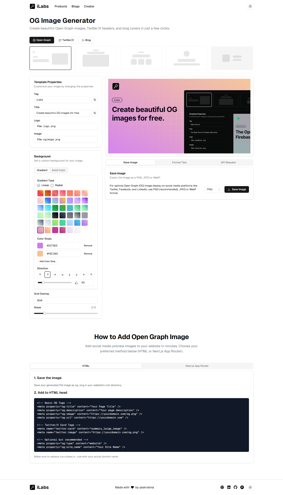
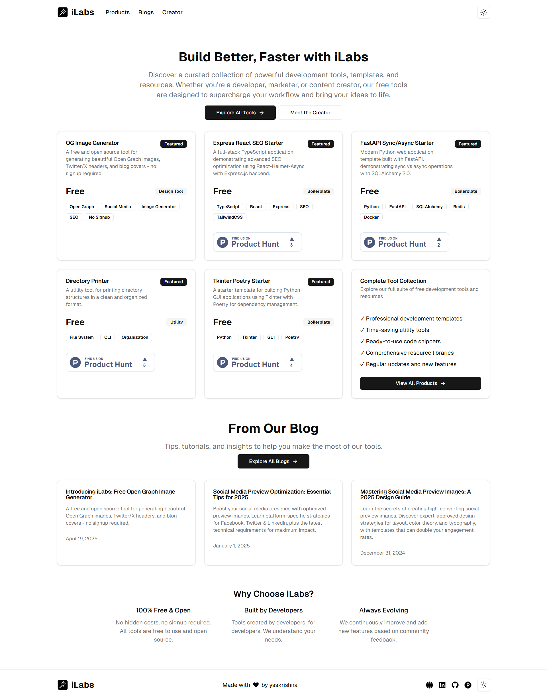
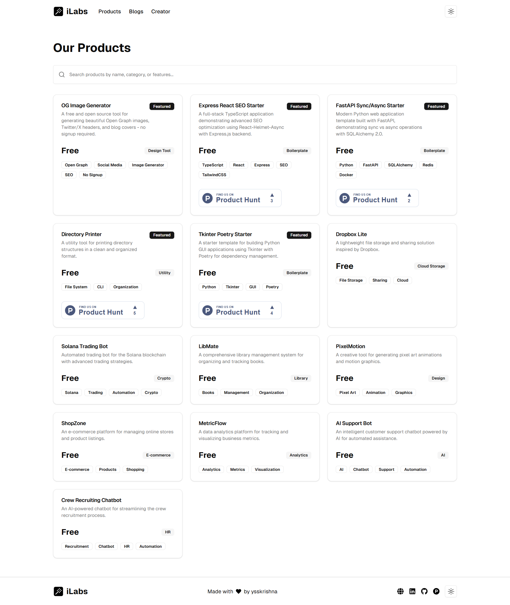
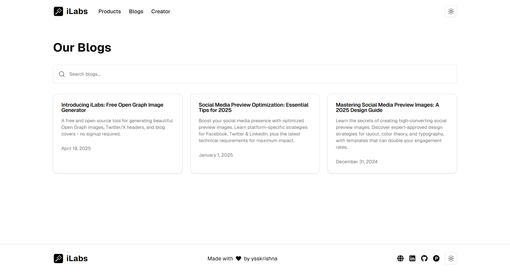
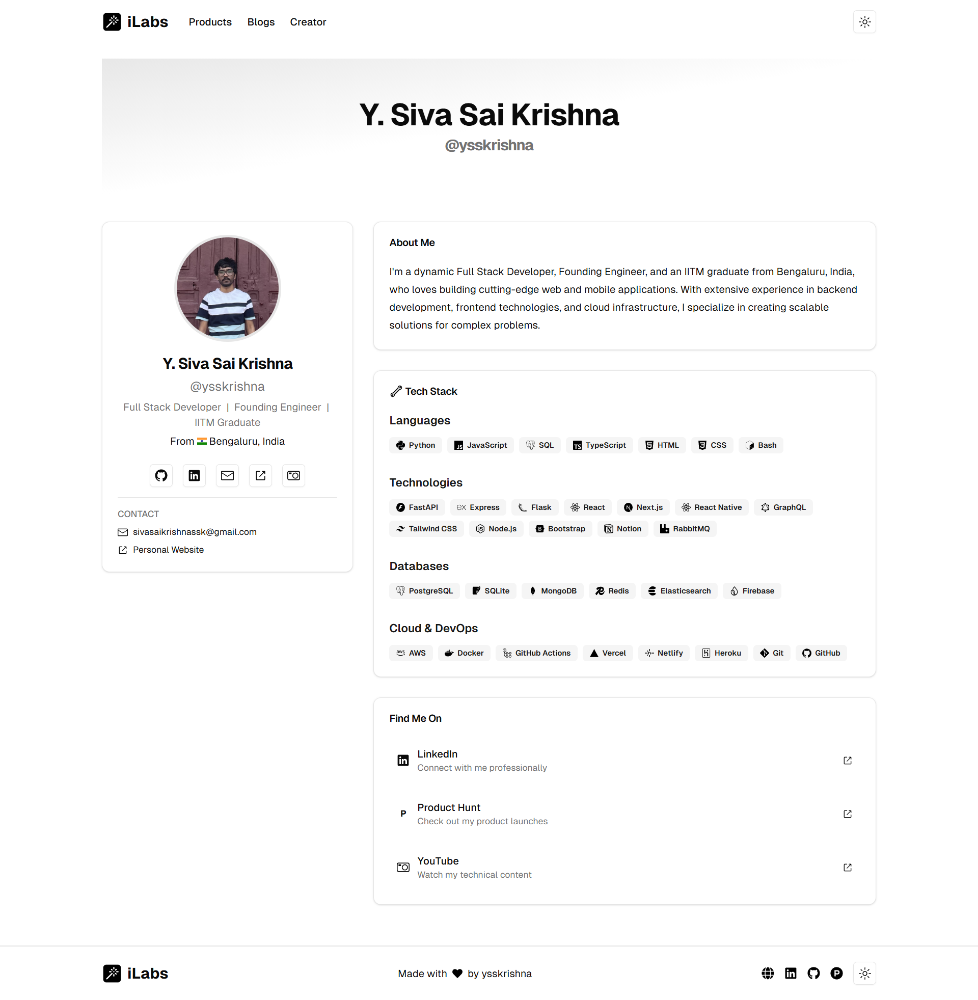
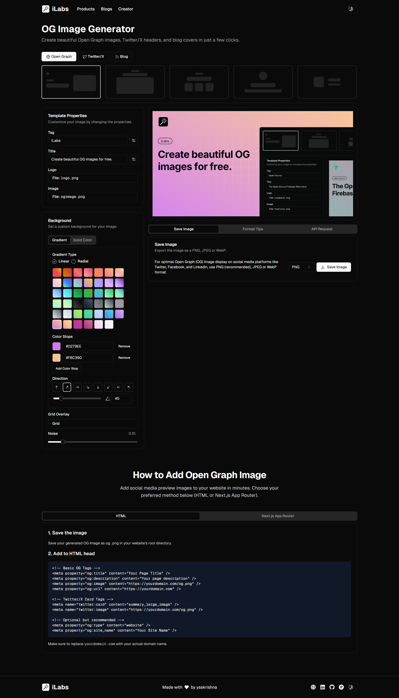
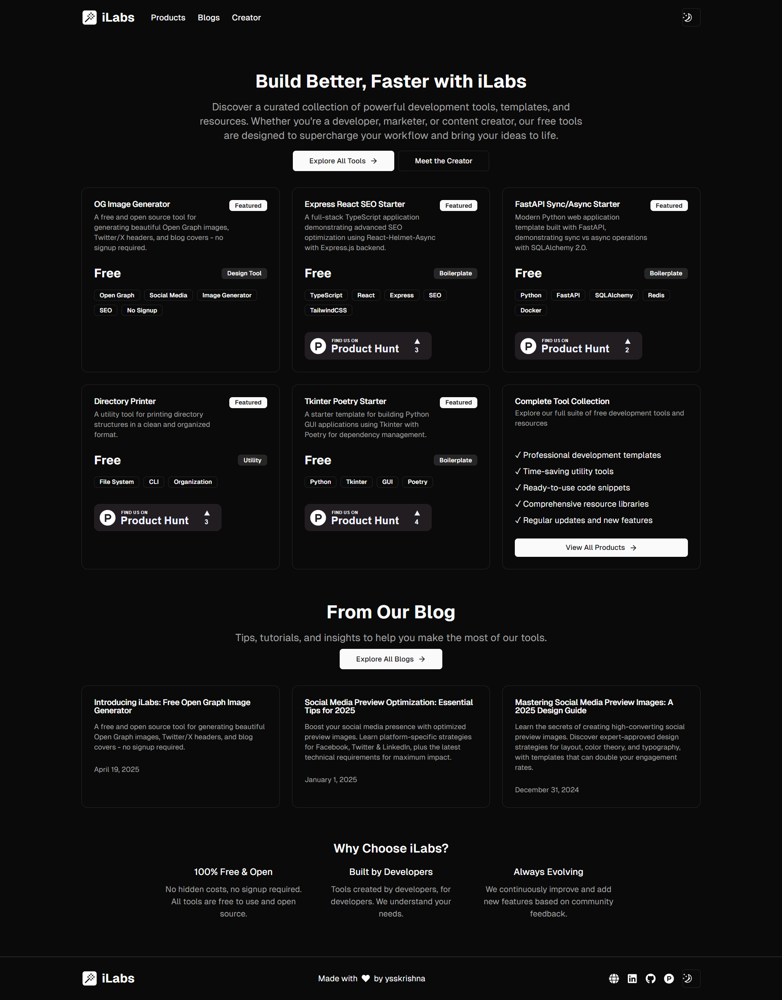
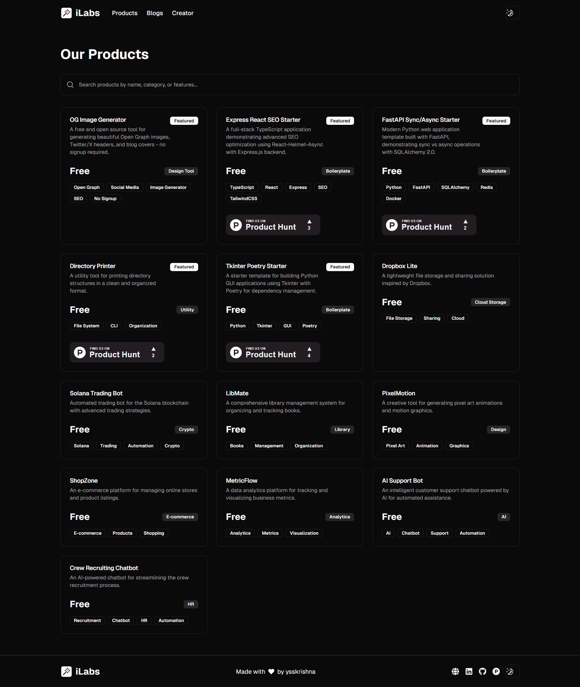
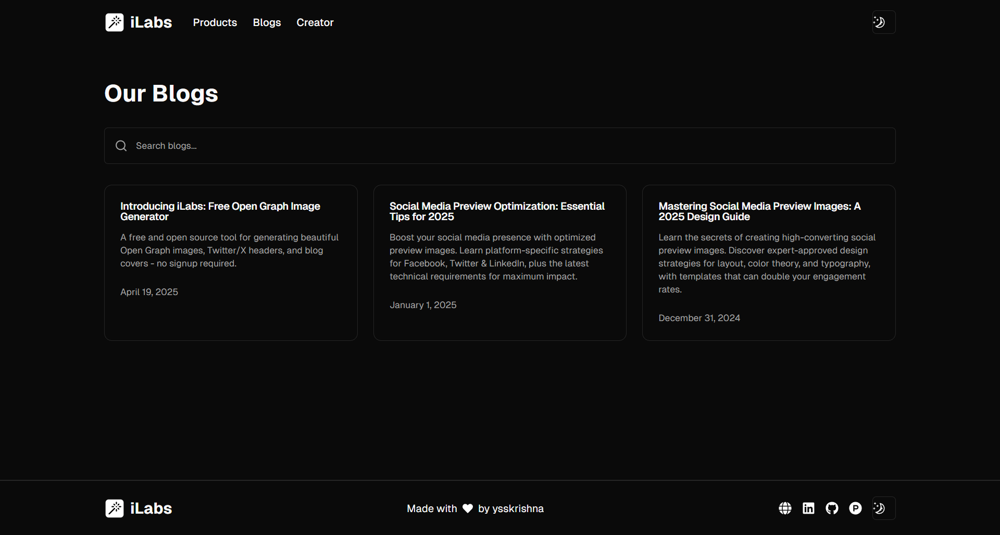
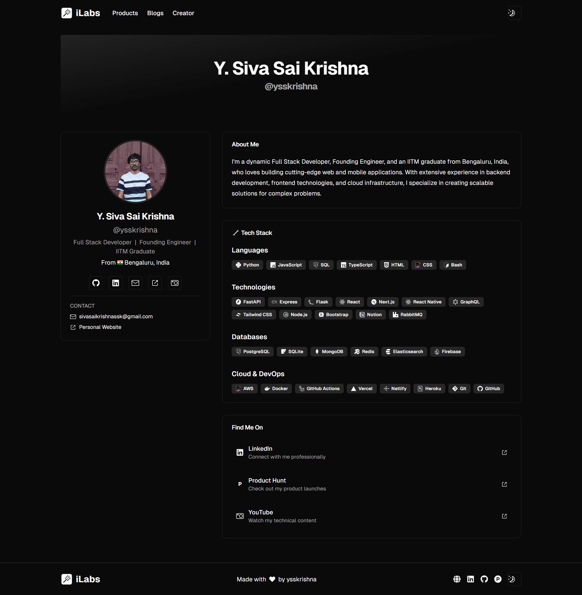

# iLabs

[](https://github.com/ysskrishna/ilabs/blob/main/LICENSE) [](https://github.com/ysskrishna/ilabs/releases) [](https://ysskrishna.space)

A collection of free developer tools and resources, including image generation tools, boilerplate templates, utility applications, and more - designed to help developers streamline their workflow and enhance their projects.

## [OG Image Generator](https://ilabs.vercel.app/products/og-image-generator)

- Enhanced linear gradient section with customizable colorcodes
- Enhanced Linear gradient with customizable angle via input and slider
- Add Radial gradient presets with customizable colorcodes
- Enhanced Solid color with customized colorcodes

## 🌐 Live Demo

Visit [https://ilabs.vercel.app](https://ilabs.vercel.app) to try the tools online.

## Screenshots

### OG Image Generator - Light Theme



### Landing Page - Light Theme



### Products Page - Light Theme



### Blogs Page - Light Theme



### Creator Page - Light Theme



### OG Image Generator - Dark Theme



### Landing Page - Dark Theme



### Products Page - Dark Theme



### Blogs Page - Dark Theme



### Creator Page - Dark Theme



## 🚀 Getting Started

### Prerequisites

- Node.js 18+
- pnpm (recommended) or npm

### Installation

1. Clone the repository:

```bash
git clone https://github.com/ysskrishna/ilabs
cd ilabs
```

2. Install dependencies:

```bash
pnpm install
```

3. Set up environment variables in `.env.local`:

```bash
NEXT_PUBLIC_BASE_URL=http://localhost:3000
NEXT_PUBLIC_API_URL=http://localhost:3000/api
NEXT_PUBLIC_GOOGLE_ID=
NEXT_PUBLIC_GOOGLE_ADSENSE_ID=
```

4. Start the development server:

```bash
pnpm dev
```

Visit `http://localhost:3000` to access the application.

## 🛠️ Tech Stack

- [Next.js 15](https://nextjs.org/)
- [TypeScript](https://www.typescriptlang.org/)
- [Tailwind CSS](https://tailwindcss.com/)
- [Radix UI](https://www.radix-ui.com/)
- [Satori](https://github.com/vercel/satori)
- [Zod](https://zod.dev/)

## 🤝 Contributing

Contributions are welcome! Please feel free to submit a Pull Request. For major changes, please open an issue first to discuss what you would like to change.

1. Fork the repository
2. Create your feature branch (`git checkout -b feature/AmazingFeature`)
3. Commit your changes (`git commit -m 'Add some AmazingFeature'`)
4. Push to the branch (`git push origin feature/AmazingFeature`)
5. Open a Pull Request

## Built and maintained by

iLabs is built and maintained by:

| | Name | GitHub | Role |
|---|------|--------|------|
|  | **Y. Siva Sai Krishna** | [@ysskrishna](https://github.com/ysskrishna) | Creator |

## Changelog

See [CHANGELOG](CHANGELOG.md) for release history.

## Support

If you find this project helpful:

- ⭐ Star the repository
- 🐛 [Report issues](https://github.com/ysskrishna/ilabs/issues)
- 🔀 Submit pull requests
- 💝 [Sponsor on GitHub](https://github.com/sponsors/ysskrishna)

## License

AGPL-3.0 © [Y. Siva Sai Krishna](https://github.com/ysskrishna) — see [LICENSE](LICENSE) for details.

---

<p align="left">
  <a href="https://github.com/ysskrishna">Author's GitHub</a> •
  <a href="https://linkedin.com/in/ysskrishna">Author's LinkedIn</a> •
  <a href="https://ysskrishna.space">Author's site</a> •
  <a href="https://github.com/weijunext/ogimage-click">ogImage.click</a> •
  <a href="https://github.com/FadyMak/imgsrc-app">imgsrc-app</a> •
  <a href="https://github.com/ysskrishna/ilabs/issues">Report Issues</a>
</p>
